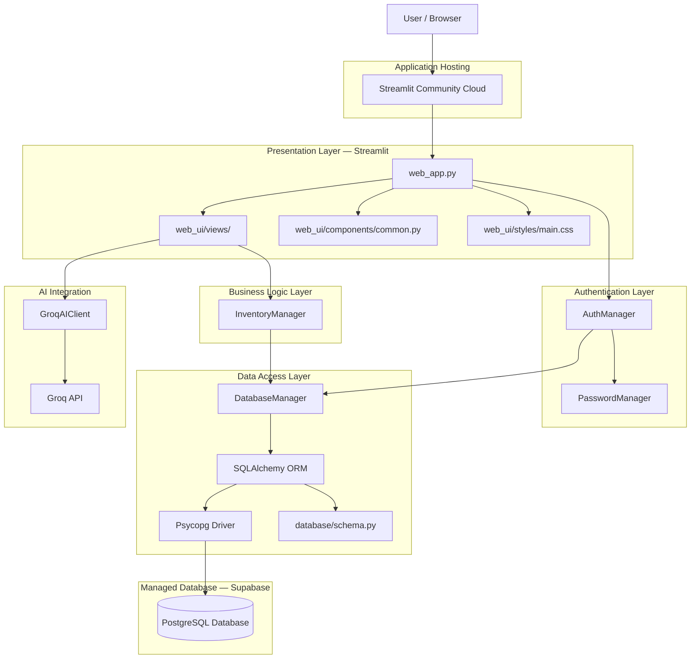

# StockPilot — System Architecture

## 1. Overview

StockPilot is a browser-based Inventory Management System built with Python and Streamlit. It follows a layered architecture that separates the presentation, authentication, business logic, data access, and AI integration layers.

The application uses **Supabase PostgreSQL** as its persistent relational database, with SQLAlchemy as its Object-Relational Mapper (ORM) and Psycopg as its PostgreSQL database driver.

Authentication is implemented internally using Argon2 password hashing. The AI Insights feature communicates with the Groq API to provide AI-powered inventory insights and restocking suggestions.

For deployment, StockPilot uses Streamlit Community Cloud as its application hosting platform and Supabase as its managed PostgreSQL database provider.

## 2. Architecture Diagram



## 3. Project Layers

### 3.1 Presentation Layer

**Location:** `web_app.py` and `web_ui/`

Responsible for displaying the application and handling user interactions.

Main responsibilities:

- Display the landing, login, and signup interfaces.
- Manage navigation between application pages.
- Display inventory information.
- Collect user input through Streamlit widgets.
- Show application feedback and validation messages.

Main components:

| Component                       | Responsibility                         |
| ------------------------------- | -------------------------------------- |
| `web_app.py`                  | Application entry point and navigation |
| `web_ui/views/`               | Individual application pages           |
| `web_ui/components/common.py` | Reusable UI components                 |
| `web_ui/styles/main.css`      | Custom application styling             |

The presentation layer communicates with the business logic and authentication layers rather than implementing database operations directly.

### 3.2 Authentication Layer

**Location:** `app/auth/`

Responsible for managing user accounts and authentication.

**AuthManager (`auth_manager.py`)**

- Handles user registration.
- Validates login credentials.
- Retrieves user information.
- Checks whether an account exists.
- Supports user authentication and account validation.

**PasswordManager (`password_manager.py`)**

- Hashes passwords using Argon2.
- Verifies submitted passwords against stored hashes.
- Avoids storing plain-text passwords.

Each authenticated user accesses inventory records associated with their own user ID. User-specific database constraints and relationships help maintain data isolation.

### 3.3 Business Logic Layer

**Location:** `app/managers/`

The business logic layer contains the main inventory operations.

**InventoryManager (`inventory_manager.py`)**

Responsible for operations involving:

- Products
- Categories
- Suppliers
- Stock management
- Inventory transactions
- Dashboard statistics

It also applies user-specific data scoping so that one account cannot access another account's inventory records through normal application operations.

### 3.4 Data Access Layer

**Location:** `app/database/`

Responsible for database configuration, connectivity, and data persistence.

**DatabaseManager (`db_manager.py`)**

- Configures the SQLAlchemy database engine.
- Manages database sessions.
- Initializes database tables.
- Handles database connectivity.
- Supports PostgreSQL connection configuration through environment variables or Streamlit secrets.

**Schema (`schema.py`)**

Defines the SQLAlchemy models and database relationships, including:

- Users
- Categories
- Suppliers
- Products
- Transactions

**Database: Supabase PostgreSQL**

StockPilot uses Supabase as its managed PostgreSQL database provider.

The database connection is established using:

- **SQLAlchemy:** Object-relational mapping and database session management.
- **Psycopg:** PostgreSQL database driver.
- **Supabase Session Pooler:** Managed connection endpoint for application connectivity.

The application reads its database connection string from the `DB_URL` configuration value. Credentials are supplied through environment variables during local development or Streamlit secrets during deployment.

The database connection string must never be committed to GitHub.

### 3.5 AI Integration Layer

**Location:** `app/ai/`

The AI integration layer provides AI-powered inventory insights.

**GroqAIClient (`groq_client.py`)**

- Connects to the Groq API.
- Sends supported inventory information for AI analysis.
- Provides AI-generated inventory insights and restocking suggestions.

The API key is loaded through the environment variable or Streamlit secret:

```env
GROQ_API_KEY=your_groq_api_key_here
```

The actual API key must remain private and must never be committed to GitHub.

## 4. Application Data Flow

### 4.1 Authentication Flow

1. A user opens StockPilot.
2. The user selects login or signup.
3. The application passes the submitted information to `AuthManager`.
4. `PasswordManager` handles password hashing or verification.
5. Authentication operations use the database layer.
6. After successful authentication, the application maintains the authenticated user's session.
7. The application loads inventory data associated with that user.

### 4.2 Inventory Management Flow

1. The user interacts with a page such as Products or Categories.
2. The Streamlit view receives the user's input.
3. The view calls the relevant `InventoryManager` method.
4. `InventoryManager` applies business rules and user-specific filtering.
5. Database operations are handled through `DatabaseManager` and SQLAlchemy.
6. Psycopg communicates with the Supabase PostgreSQL database.
7. PostgreSQL stores or retrieves the requested information.
8. The result is returned to the view and displayed to the user.

### 4.3 AI Insights Flow

1. The user opens AI Insights.
2. The application retrieves the relevant inventory information.
3. `GroqAIClient` prepares the AI request.
4. The request is sent to the Groq API.
5. The generated response is returned to the application.
6. Streamlit displays the result.

AI functionality requires a valid Groq API key.

## 5. Database Configuration and Connectivity

StockPilot separates database credentials from application source code.

The database connection is configured through:

**Local Development**

```toml
DB_URL = "your_supabase_postgresql_connection_url"
```

This value is stored in the local `.streamlit/secrets.toml` file or supplied through an environment variable.

**Streamlit Community Cloud**

The database connection string is configured through the application's Secrets settings.

The application uses the same Supabase PostgreSQL database in both environments.

Sensitive configuration files and credentials are excluded from Git using `.gitignore`.

## 6. Deployment Architecture

StockPilot uses the following deployment architecture:

| Component                   | Technology                | Responsibility                                   |
| --------------------------- | ------------------------- | ------------------------------------------------ |
| Application hosting         | Streamlit Community Cloud | Hosts and runs the web application               |
| Database hosting            | Supabase                  | Provides managed PostgreSQL storage              |
| Database connectivity       | SQLAlchemy and Psycopg    | Handles database operations                      |
| Database connection pooling | Supabase Session Pooler   | Provides managed database connectivity           |
| AI service                  | Groq API                  | Provides AI-powered insights                     |
| Source control              | GitHub                    | Stores application source code and documentation |

### Deployment Flow

1. Application source code is maintained in GitHub.
2. Streamlit Community Cloud retrieves the selected repository and branch.
3. Streamlit installs the dependencies listed in `requirements.txt`.
4. Application secrets are configured securely through Streamlit.
5. The application connects to Supabase PostgreSQL using `DB_URL`.
6. Inventory and authentication data are stored persistently in Supabase.
7. AI Insights communicates with the Groq API using `GROQ_API_KEY`.

Supabase provides persistent database storage independently of the Streamlit application's filesystem. Therefore, application restarts or redeployments do not remove database records.

## 7. Architectural Principles

StockPilot follows these principles:

- **Separation of concerns:** Each layer has a clearly defined responsibility.
- **Reusability:** Shared UI components reduce duplicated interface code.
- **Maintainability:** Authentication, database operations, and business logic are separated.
- **Data isolation:** Inventory operations are scoped to the authenticated user.
- **Secure password handling:** Passwords are stored as Argon2 hashes rather than plain text.
- **Centralized data access:** Database operations are handled through the database and business logic layers.
- **Configuration security:** Database credentials and API keys are managed outside the source code.
- **Persistent storage:** Supabase PostgreSQL provides durable cloud database storage.

## 8. Technology Stack

| Technology                | Purpose                                 |
| ------------------------- | --------------------------------------- |
| Python                    | Main programming language               |
| Streamlit                 | Web application framework               |
| Supabase PostgreSQL       | Managed relational database             |
| SQLAlchemy                | Object-relational mapping               |
| Psycopg                   | PostgreSQL database driver              |
| Argon2                    | Password hashing                        |
| Groq API                  | AI-powered inventory insights           |
| Pandas                    | Data handling and reporting             |
| CSS                       | Custom UI styling                       |
| Git and GitHub            | Version control and source code hosting |
| Streamlit Community Cloud | Application deployment and hosting      |

## 9. Future Improvements

Potential future improvements include:

- Automated testing for inventory operations.
- Improved application logging and error handling.
- Database backup and recovery procedures.
- Database migration management using Alembic.
- Additional reporting and analytics.
- More comprehensive monitoring and deployment checks.
- Enhanced role-based access control.

---

**Document:** System Architecture
**Project:** StockPilot — Inventory Management System
**Database:** Supabase PostgreSQL
**Application Hosting:** Streamlit Community Cloud
**Status:** Updated architecture for PostgreSQL deployment
