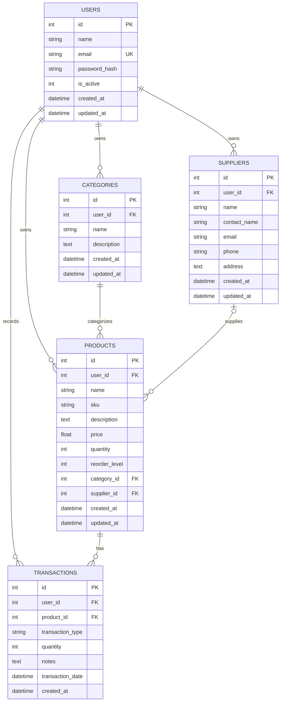

# StockPilot — Database Design

## 1. Overview

StockPilot uses **PostgreSQL**, hosted on **Supabase**, as its relational database. SQLAlchemy is used as the Object-Relational Mapping (ORM) tool, while Psycopg 3 provides the PostgreSQL database connection.

The database stores user accounts and inventory-related information, including categories, suppliers, products, and stock transactions.

The database schema is defined in:

```text
app/database/schema.py
```

Database connection and session management are handled through:

```text
app/database/db_manager.py
```

The application obtains its database connection URL through the `DB_URL` configuration variable. Locally, it can be configured using `.streamlit/secrets.toml` or an environment variable. In Streamlit Community Cloud, it is configured through the application's Secrets settings.

Supabase PostgreSQL is the persistent database used by the deployed application.

## 2. Database Tables

StockPilot currently defines five database tables.

| Table            | Description                                                   |
| ---------------- | ------------------------------------------------------------- |
| `users`        | Stores user account information and authentication details.   |
| `categories`   | Stores product categories belonging to individual users.      |
| `suppliers`    | Stores supplier contact and business information.             |
| `products`     | Stores product details, prices, quantities, and stock levels. |
| `transactions` | Records stock-in and stock-out operations.                    |

## 3. Entity Relationship Diagram

The following diagram illustrates the relationships between the database tables.



*Figure 1: StockPilot Database Entity Relationship Diagram.*

## 4. Table Details

### 4.1 Users Table

**Table name:** `users`

Stores registered user accounts.

| Column            | Data type   | Constraints                 |
| ----------------- | ----------- | --------------------------- |
| `id`            | Integer     | Primary key, auto-increment |
| `name`          | String(150) | Not null                    |
| `email`         | String(255) | Not null, unique, indexed   |
| `password_hash` | String(255) | Not null                    |
| `is_active`     | Integer     | Not null, default 1         |
| `created_at`    | DateTime    | Not null                    |
| `updated_at`    | DateTime    | Not null                    |

**Important considerations:**

- Email addresses must be unique.
- Passwords are stored as Argon2 hashes, not plain-text values.
- The `is_active` field indicates whether an account is active.
- Each user can own multiple categories, suppliers, products, and transactions.

### 4.2 Categories Table

**Table name:** `categories`

Stores product categories created by users.

| Column          | Data type   | Constraints                 |
| --------------- | ----------- | --------------------------- |
| `id`          | Integer     | Primary key, auto-increment |
| `user_id`     | Integer     | Foreign key to users        |
| `name`        | String(100) | Not null                    |
| `description` | Text        | Nullable                    |
| `created_at`  | DateTime    | Timestamp                   |
| `updated_at`  | DateTime    | Timestamp                   |

**Important constraints:**

- Every category belongs to a user.
- A user cannot create two categories with the same name.
- Different users can have categories with identical names.
- Deleting a user cascades to their categories.

Unique constraint:

```text
(user_id, name)
```

### 4.3 Suppliers Table

**Table name:** `suppliers`

Stores supplier information.

| Column           | Data type   | Constraints                 |
| ---------------- | ----------- | --------------------------- |
| `id`           | Integer     | Primary key, auto-increment |
| `user_id`      | Integer     | Foreign key to users        |
| `name`         | String(150) | Not null                    |
| `contact_name` | String(150) | Nullable                    |
| `email`        | String(150) | Nullable                    |
| `phone`        | String(50)  | Nullable                    |
| `address`      | Text        | Nullable                    |
| `created_at`   | DateTime    | Timestamp                   |
| `updated_at`   | DateTime    | Timestamp                   |

**Important considerations:**

- Every supplier belongs to a specific user.
- Contact information is optional.
- A supplier can be associated with multiple products.
- Deleting a user cascades to their suppliers.

### 4.4 Products Table

**Table name:** `products`

Stores the main inventory records.

| Column            | Data type   | Constraints                     |
| ----------------- | ----------- | ------------------------------- |
| `id`            | Integer     | Primary key, auto-increment     |
| `user_id`       | Integer     | Foreign key to users            |
| `name`          | String(200) | Not null                        |
| `sku`           | String(100) | Not null                        |
| `description`   | Text        | Nullable                        |
| `price`         | Float       | Not null                        |
| `quantity`      | Integer     | Not null, default 0             |
| `reorder_level` | Integer     | Not null, default 10            |
| `category_id`   | Integer     | Not null, composite foreign key |
| `supplier_id`   | Integer     | Nullable, composite foreign key |
| `created_at`    | DateTime    | Timestamp                       |
| `updated_at`    | DateTime    | Timestamp                       |

**Important constraints:**

- Every product belongs to a user.
- SKU values must be unique for each user.
- Every product must have a category.
- A supplier is optional.
- Category and supplier references must belong to the same user as the product.
- A category or supplier referenced by a product cannot be deleted while the product references it because the corresponding foreign keys use `RESTRICT`.

Unique constraint:

```text
(user_id, sku)
```

### 4.5 Transactions Table

**Table name:** `transactions`

Stores stock movement records.

| Column               | Data type | Constraints                 |
| -------------------- | --------- | --------------------------- |
| `id`               | Integer   | Primary key, auto-increment |
| `user_id`          | Integer   | Foreign key to users        |
| `product_id`       | Integer   | Composite foreign key       |
| `transaction_type` | Enum      | STOCK_IN or STOCK_OUT       |
| `quantity`         | Integer   | Not null                    |
| `notes`            | Text      | Nullable                    |
| `transaction_date` | DateTime  | Timestamp                   |
| `created_at`       | DateTime  | Timestamp                   |

**Supported transaction types:**

- `STOCK_IN`: Records stock added to inventory.
- `STOCK_OUT`: Records stock removed from inventory.

**Important considerations:**

- Every transaction belongs to a user.
- Every transaction references a product.
- A transaction can only reference a product owned by the same user.
- Deleting a product cascades to its associated transactions.
- Deleting a user cascades to their transactions.

## 5. Database Relationships

The database uses the following relationships:

| Relationship            | Type        | Explanation                                     |
| ----------------------- | ----------- | ----------------------------------------------- |
| User → Categories      | One-to-Many | A user can create multiple categories.          |
| User → Suppliers       | One-to-Many | A user can manage multiple suppliers.           |
| User → Products        | One-to-Many | A user can manage multiple products.            |
| User → Transactions    | One-to-Many | A user can have multiple transactions.          |
| Category → Products    | One-to-Many | A category can contain multiple products.       |
| Supplier → Products    | One-to-Many | A supplier can supply multiple products.        |
| Product → Transactions | One-to-Many | A product can have multiple stock transactions. |

A product must belong to exactly one category and can optionally reference one supplier.

## 6. User Data Isolation

One of StockPilot's important database design decisions is user-specific data isolation.

Inventory records contain a `user_id` column that associates them with their owner.

The schema also uses composite foreign keys to prevent cross-user relationships.

For example, a product references its category using:

```text
(category_id, user_id)
    references
(categories.id, categories.user_id)
```

Similarly, supplier and transaction relationships include `user_id`.

This means a product cannot reference another user's category or supplier, and a transaction cannot reference another user's product.

Additional unique constraints support these composite references:

```text
UNIQUE (id, user_id)
```

These constraints are defined for categories, suppliers, and products.

**Note:** Database constraints complement the user-scoped queries implemented in the application. Both are important for data isolation.

## 7. Referential Integrity and Cascading Rules

StockPilot uses foreign-key constraints to maintain relationships between records.

| Relationship            | Delete behavior |
| ----------------------- | --------------- |
| User → Categories      | CASCADE         |
| User → Suppliers       | CASCADE         |
| User → Products        | CASCADE         |
| User → Transactions    | CASCADE         |
| Category → Products    | RESTRICT        |
| Supplier → Products    | RESTRICT        |
| Product → Transactions | CASCADE         |

**CASCADE:** Related records are deleted when their referenced parent record is deleted.

**RESTRICT:** A referenced category or supplier cannot be deleted while a product still uses it.

These rules help prevent orphaned records and maintain database consistency.

## 8. Indexing and Unique Constraints

The schema uses indexes and unique constraints to support data integrity and lookups.

Examples include:

- Unique index on user email.
- Indexes on `user_id` columns.
- Unique category names within each user account.
- Unique product SKUs within each user account.
- Composite unique constraints on entity IDs and user IDs.

## 9. Timestamp Management

The schema uses `datetime.utcnow` as the default timestamp function.

The following fields track record creation and updates:

- `created_at`: Records when an entity was created.
- `updated_at`: Records when an entity was last updated.

Transactions additionally include `transaction_date` to record when the stock movement occurred.

## 10. Database Technology and Connection

StockPilot uses the following database technologies:

| Technology             | Purpose                                                |
| ---------------------- | ------------------------------------------------------ |
| Supabase PostgreSQL    | Hosted relational database and persistent data storage |
| SQLAlchemy             | ORM and database interaction                           |
| Psycopg 3              | PostgreSQL database driver                             |
| Foreign Keys           | Referential integrity                                  |
| Unique Constraints     | Prevent duplicate records                              |
| Composite Foreign Keys | Enforce ownership consistency                          |

### Database Connection

The database engine and session configuration are managed through:

```text
app/database/db_manager.py
```

The database models are defined in:

```text
app/database/schema.py
```

The application uses a PostgreSQL connection URL supplied through the `DB_URL` configuration variable.

The connection uses Supabase's Session Pooler:

- **Database provider:** Supabase
- **Database engine:** PostgreSQL
- **Connection mode:** Session Pooler
- **Port:** 5432
- **Driver:** Psycopg 3
- **ORM:** SQLAlchemy

### Environment Configuration

For local development, the database connection can be configured in:

```text
.streamlit/secrets.toml
```

For Streamlit Community Cloud, the connection URL is configured through the application's Secrets settings.

Example configuration:

```toml
DB_URL = "YOUR_SUPABASE_POSTGRESQL_CONNECTION_URL"
```

Actual database credentials must never be committed to GitHub or included in public documentation.

### Database Initialization

SQLAlchemy's `Base.metadata.create_all()` is used to create database tables that do not already exist.

This initializes the schema for a new database. It does not automatically migrate existing tables when the schema changes.

## 11. Design Considerations

The current database design focuses on:

- Supporting multiple user accounts.
- Keeping inventory records associated with their owners.
- Preventing duplicate category names and product SKUs within an account.
- Maintaining valid relationships between inventory records.
- Preserving transaction history while the referenced product exists.
- Keeping database access centralized through SQLAlchemy.
- Using Supabase PostgreSQL for persistent hosted storage.
- Keeping database credentials outside the source code.

---

**Document:** Database Design
**Project:** StockPilot — Inventory Management System
**Database:** Supabase PostgreSQL
**ORM:** SQLAlchemy
**Driver:** Psycopg 3
**Status:** Updated for PostgreSQL deployment
